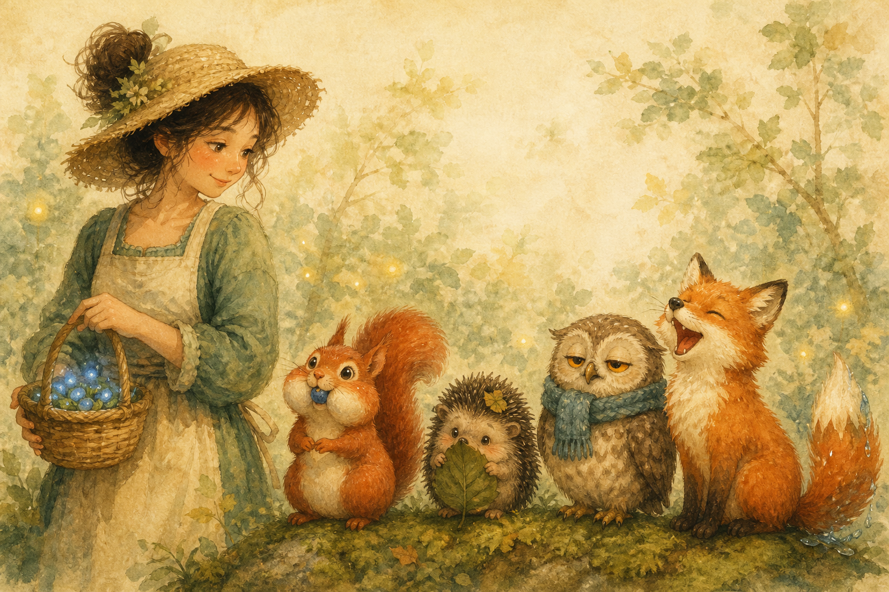
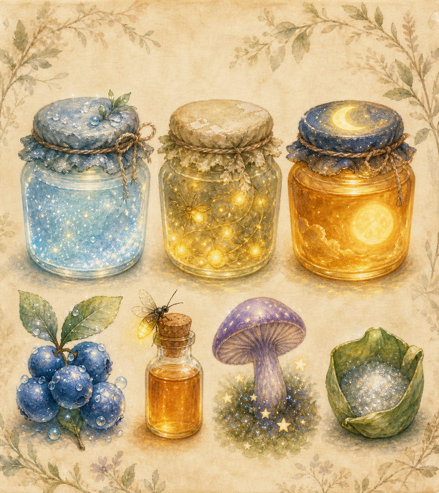

# 달빛 잼 항아리 (Moonlight Jam Jar)

<p align="center">
  
</p>

> 할머니의 오두막을 물려받은 보리가, 숲속 이웃 여섯 명의 소원을 모아 별빛 축제를 여는 이야기.

iOS 17+ · SwiftUI · Swift 5.9 · StoreKit 2 · XcodeGen · iPhone 세로 화면

동화책 한 장을 넘기는 감각으로 만든 모바일 스토리 게임입니다. 대화를 읽고, 숲에서 빛나는 재료를 주워 담고, 솥단지 앞에서 불을 조절하고, 이웃에게 마법 잼을 건네면서 일기장을 채웁니다. 여기에 **달의 위상**, **잼 병 꾸미기와 다락 선반**, **이웃의 밤사이 역선물 우체통**, **모닥불 집중 타이머** 네 가지 오리지널 기능이 더해졌고, 여기에 **솥단지 마무리 불 조절 타이밍 게임**과 **이웃의 오늘의 비밀 주문서**가 함께 들어갑니다. 무료 플레이(프롤로그~에필로그)는 그대로 끝까지 즐길 수 있습니다.

## 게임 소개

- **장르**: 따뜻한 동화 스토리 + 채집/잼 담그기 미니게임 + 관계 성장 + 생활 확장
- **플레이 타임**: 본편 **현실의 6일 이상 · 하루 30~50분**(총 4~7시간), 확장 콘텐츠와 주문서까지 포함하면 그 이상. 한 번 앉아서 끝나지 않도록 하루 단위로 열리는 구조입니다
- **구성**: 프롤로그 + 3개 장 + 에필로그, 총 9개 장면 / 잼 12종(본편 7 + 확장 5) / 일기장 21칸(+확장 9칸) / 미니게임 3종(채집·불 조절·마무리) / 하루 단위 주문서
- **저장**: 모든 행동이 자동 저장되고, 앱을 껐다 켜도 이어서 플레이할 수 있습니다
- **조작**: 한 손. 화면을 누르고, 재료를 고르고, 불 앞에서 젓는 것이 전부입니다

## 세계관

달빛 숲 외곽, 버스가 더는 가지 않는 길 끝에 할머니의 오두막이 있습니다. 할머니는 매년 보름밤에 **별빛 축제**를 열었습니다. 숲의 이웃 네 명이 각자 소원을 하나씩 내걸고, 그것이 한 식탁에 모이면 숲이 스스로 불을 밝힌다는 이야기입니다.

마지막 축제는 아무도 오지 않았습니다. 할머니가 떠난 뒤, 오두막에는 수첩 한 권과 누렇게 바랜 초대장만 남았습니다. 도시에서 내려온 보리는 그 수첩을 펼치고, 이번 축제는 자기가 모아 보기로 합니다.

이 숲의 재료는 밭에서 나지 않습니다. 새벽 이슬이 맺힌 자리에만 열리는 **이슬방울 베리**, 노을빛을 머금은 꽃에서 반딧불이가 모아 둔 **반딧불 꽃꿀**, 별가루를 머금은 이끼 아래에서 자라는 **별이끼 버섯**, 보름달이 뜬 밤에만 나무껍질에 맺히는 **달조각 향신료**. 이 네 가지를 솥단지에 넣으면, 뚜껑을 열었을 때 작은 빛이 한 번 떠오르는 잼이 됩니다.

숲은 달을 보고 움직입니다. 달이 꽉 차면 담장 사이로 **달빛 비밀 정원**의 길이 열리고, 그곳에서만 **월광 이슬**이 흐릅니다. 그리고 에필로그가 끝난 다음 날, 오두막 뒤편의 담장이 **사계절 온실**의 문이 되었다는 것을 보리가 알게 됩니다.

이 게임의 목표는 싸우거나 이기는 것이 아니라, **이웃의 소원을 들을 만큼 가까워지는 것**입니다.

제목 『달빛 잼 항아리』는 보름밤마다 잼을 담그던 할머니의 부엌을 가리키는 이름입니다. 게임 안에서 새벽이슬 잼과 반딧불 스파클 잼을 처음 담그면, 그 부엌의 레시피가 일기장에 한 칸씩 남습니다.

## 등장인물



### 보리 (플레이어)

할머니의 오두막을 물려받은 사람. 잼은 수첩을 보며 배우는 중이고, 이름을 외우는 데는 빠릅니다. 이웃의 소원을 들을 때까지 축제는 열리지 않는다는 사실을 수첩에서 읽고, 조금씩 숲으로 걸어 나갑니다.

| 이름 | 종 | 성격 | 좋아하는 잼 | 특징 |
| --- | --- | --- | --- | --- |
| **토리** | 다람쥐 | 아침부터 부지런하고 말이 많다. 셈이 빠르지만 남의 바구니가 비면 자기 이슬방울 베리를 먼저 내민다 | 유성우 베리 콩포트 | 볼주머니에 이슬방울 베리를 두 알 넣고 다닌다. 숲의 소식을 가장 먼저 안다 |
| **송이** | 고슴도치 | 낯을 많이 가려 말을 걸면 잎 뒤에 숨는다. 대신 자기 정원의 별이끼 버섯 이름은 전부 외우고 있다 | 달그림자 허브 젤리 | 등에 걸린 나뭇잎을 떼지 않는다. 정원 화분마다 이름을 붙이고 싶어 한다 |
| **몽** | 올빼미 | 밤에만 눈을 뜨는 서재지기. 감정을 말로 잘 하지 않아 다정함을 책갈피에 끼워 둔다 | 별빛 안개 잼 | 목도리는 스스로 짠 것. 할머니가 두고 간 반딧불 꽃꿀차를 아직 기억한다 |
| **루비** | 여우 | 숲에서 제일 수다스럽다. 소문을 옮기는 걸 좋아하지만 어려운 이웃의 이야기는 함부로 꺼내지 않는다 | 반딧불 스파클 잼 | 꼬리 끝이 늘 살짝 젖어 있다. 아침에 인사할 사람이 없어서 혼자 노래한다 |
| **루나** | 사슴 | 유리 지붕 아래에서 계절을 옮겨 심는 온실지기. 밤마다 유리 위로 지나가는 별을 세어 종이에 적는다 | 겨울 눈꽃 잼 | 뿔 한쪽에 눈이 쌓여 있다. 털어도 다음 날이면 다시 쌓인다 |
| **코코** | 수달 | 온실 연못에서 조약돌을 굴리며 사는 수달. 손이 빠르고 웃음이 잦다 | 봄 벚꽃꿀 잼 | 조약돌 일곱 개를 순서대로 굴린다. 겨울 칸에서 가져온 돌이 아직 따뜻하다 |

본편 이웃 네 명(토리·송이·몽·루비)은 각자 **소원**이 하나씩 있고, 호감도가 `단짝`에 이르면 그 소원을 말해 줍니다. 온실지기 두 명(루나·코코)은 **「사계절 온실 확장팩」**을 열면 유리 지붕 아래에서 처음 만나며, 첫 대화와 단짝이 된 뒤의 대화가 따로 있습니다.

## 주요 판타지 재료 & 챕터 필수 잼/아이템



### 채집 재료 8종

재료는 세 등급으로 나뉘고, 채집터마다 드랍표가 정해져 있습니다. **고급 재료는 어느 채집터에서든 22%**로 묶여 있고, **희귀 재료는 10%**로 달빛이 필요한 자리에서만 조금씩 나옵니다.

| 재료 | 영어 이름 | 등급 | 나오는 곳 | 채집 점수 | 특징 |
| --- | --- | --- | --- | --- | --- |
| 🫐 **이슬방울 베리** | Dewdrop Berry | 흔함 | 오두막 부엌 · 이슬방울 덤불 · 반딧불이 연못 · 몽의 서재 · 별빛 축제터 | 10 | 해가 뜨기 전에만 이슬이 맺히는 덤불에서 반짝이는 푸른 빛으로 익는다 |
| 🍄 **별이끼 버섯** | Star-moss Shroom | 흔함 | 오두막 부엌 · 이슬방울 덤불 · 몽의 서재 · 별빛 축제터 | 12 | 별가루를 머금은 이끼 아래에서 자란다. 손끝에서 별이 톡톡 터진다 |
| 🍯 **반딧불 꽃꿀** | Firefly Nectar | 흔함 | 오두막 부엌 · 반딧불이 연못 · 별빛 축제터 | 15 | 노을빛을 머금은 꽃에서 반딧불이가 한 방울씩 모아 둔 황금빛 꽃꿀 |
| 🌙 **달조각 향신료** | Moonflake Spice | **고급** | 모든 채집터 · 22% | 20 | 보름달이 뜨는 밤에만 나무껍질에 맺히는 은빛 가루. 달바람이 불 때 걷어야 한다 |
| 💧 **월광 이슬** | Moonlit Dew | **희귀** | 달빛 비밀 정원 (보름달 밤) · 10% | 30 | 달이 꽉 찬 밤에만 잎맥을 따라 흐르는 물방울. 손에 닿으면 달빛이 된다 |
| 🌸 **봄 벚꽃꿀** | Cherry Blossom Honey | 고급 | 사계절 온실 · 봄 칸 · 22% 중 11% | 18 | 온실의 벚나무가 봄에만 흘리는 꿀. 따뜻한 유리 아래에서 열두 달 봄을 견딘다 |
| 🍁 **가을 단풍 수액** | Maple Sap | 고급 | 사계절 온실 · 가을 칸 · 22% 중 11% | 16 | 온실 북쪽 벽의 단풍나무에서 밤새 떨어지는 수액. 식으면 조용히 굳는다 |
| ❄️ **겨울 눈꽃** | Snow Blossom | **희귀** | 사계절 온실 · 겨울 칸 · 10% | 22 | 천장에 내려앉은 눈이 꽃잎 모양으로 맺힌 것. 만지면 손끝이 시리다 |

**채집터별 드랍표** (합 100 = 확률 %)

| 채집터 | 흔함 | 고급 | 희귀 |
| --- | --- | --- | --- |
| 오두막 부엌 | 이슬방울 베리 48 · 반딧불 꽃꿀 30 | 달조각 향신료 22 | — |
| 이슬방울 덤불 | 이슬방울 베리 56 · 별이끼 버섯 22 | 달조각 향신료 22 | — |
| 반딧불이 연못 | 반딧불 꽃꿀 50 · 이슬방울 베리 28 | 달조각 향신료 22 | — |
| 몽의 서재 | 별이끼 버섯 46 · 이슬방울 베리 20 · 반딧불 꽃꿀 12 | 달조각 향신료 22 | — |
| 별빛 축제터 | 이슬방울 베리 30 · 반딧불 꽃꿀 26 · 별이끼 버섯 22 | 달조각 향신료 22 | — |
| 달빛 비밀 정원 | 이슬방울 베리 34 · 별이끼 버섯 34 | 달조각 향신료 22 | 월광 이슬 10 |
| 사계절 온실 | 이슬방울 베리 68 | 봄 벚꽃꿀 11 · 가을 단풍 수액 11 | 겨울 눈꽃 10 |

### 잼 12종

앞의 7가지는 본편(프롤로그~에필로그) 수첩에 실린 레시피입니다.

| 잼 | 재료 | 온기 | 처음 등장하는 장 | 특히 좋아하는 이웃 |
| --- | --- | --- | --- | --- |
| 새벽이슬 잼 | 이슬방울 베리 ×2 | 1 | 프롤로그 | 몽 |
| 반딧불 스파클 잼 | 이슬방울 베리 + 반딧불 꽃꿀 | 1 | 1장 | 루비 |
| 별빛 안개 잼 | 이슬방울 베리 + 별이끼 버섯 | 2 | 1장 | 몽 |
| 구름솜 마멀레이드 | 반딧불 꽃꿀 + 달조각 향신료 | 2 | 1장 | 루비 |
| 유성우 베리 콩포트 | 이슬방울 베리 + 별이끼 버섯 + 달조각 향신료 | 3 | 2장 | 토리 |
| 달그림자 허브 젤리 | 별이끼 버섯 + 달조각 향신료 | 2 | 2장 | 송이 |
| 황금 보름달 잼 | 반딧불 꽃꿀 + 별이끼 버섯 + 달조각 향신료 | 3 | 3장 | 토리 |

확장 레시피는 **사계절 온실 확장팩**에서, 비밀 레시피는 **우체통 쪽지**로 열립니다.

| 잼 | 재료 | 온기 | 여는 방법 | 특히 좋아하는 이웃 |
| --- | --- | --- | --- | --- |
| 봄 벚꽃꿀 잼 | 봄 벚꽃꿀 + 이슬방울 베리 | 1 | 사계절 온실 확장팩 | 코코 |
| 가을 단풍 콩포트 | 가을 단풍 수액 + 별이끼 버섯 | 2 | 사계절 온실 확장팩 | 코코 |
| 겨울 눈꽃 잼 | 겨울 눈꽃 + 달조각 향신료 + 월광 이슬 | 3 | 사계절 온실 확장팩 | 루나 |
| 비 오는 날의 잼 | 이슬방울 베리 + 달조각 향신료 | 1 | 우체통 쪽지 | — |
| 첫서리 젤리 | 반딧불 꽃꿀 + 별이끼 버섯 | 2 | 우체통 쪽지 | — |

조합은 **재료의 종류와 개수**만 봅니다. 넣는 순서는 결과에 영향을 주지 않습니다. 새벽이슬 잼처럼 같은 재료를 두 번 넣는 레시피도 있어서, 바구니에서 같은 재료를 연달아 눌러 담을 수 있습니다(솥에 넣은 재료 칩을 누르면 하나씩 빠집니다). 수첩에 없는 조합은 "뭉근한 잼"이 되며 가장 비슷한 레시피를 힌트로 알려 줍니다. 단, **비밀 레시피는 쪽지를 받기 전까지는 수첩에 없는 조합으로 취급**됩니다.

### 챕터별 해금 필수 요소

| 장 | 이야기에서 필요한 것 | 플레이로 채우는 필수 요소 | 열리면 새로 생기는 것 |
| --- | --- | --- | --- |
| 프롤로그 · 할머니의 오두막 | 화분 밑의 열쇠, 수첩 | 처음부터 (오두막 부엌에서 바로 잼 담그기 가능) | 부엌 · 이슬방울 덤불 · 반딧불이 연못 · 몽의 서재 |
| 1장 · 이웃의 이름 | 몽과 루비의 첫 대화 | 프롤로그 완료 | 몽의 서재와 연못에서 달조각 향신료·별이끼 버섯 채집, 달빛 비밀 정원 |
| 2장 · 숲의 솥단지 | 송이의 정원, 첫 솥단지 | 1장 완료 + **재료 10개 이상 채집** + **서로 다른 잼 2가지** | 송이의 정원(별이끼 버섯), 2장 잼 레시피 |
| 3장 · 축제를 준비하는 밤 | 네 사람의 소원 | 2장 완료 + 네 이웃 모두 `인사하는 사이` + **서로 다른 잼 5가지** | 축제 등불 재료, 황금 보름달 잼 레시피 |
| 에필로그 · 별빛 아래에서 | 다섯 컵이 놓인 식탁 | 3장 완료 + **황금 보름달 잼** + 네 이웃 모두 `단짝` | 별빛 축제터, 축제 일기장, **오늘의 주문서** |

챕터 해금은 `ChapterRules` 한 곳에서만 판정하고, 지도 화면의 체크리스트·해금 알림·안내 문구가 모두 같은 함수에서 나옵니다. 본편 해금 조건은 **본편 이웃 네 명**만 세므로, 확장 이웃을 만나지 않아도 이야기를 끝까지 진행할 수 있습니다.

### 호감도 단계와 하루의 호흡

| 단계 | 문턱 | 의미 |
| --- | --- | --- |
| 낯가림 | 0 | 아직 눈을 잘 못 마주친다 |
| 인사하는 사이 | 20 | 마주치면 고개를 끄덕여 준다. 우체통 편지와 주문서가 열린다 |
| 단짝 | **150** | 소원을 말해 준다. 에필로그의 조건 |
| 가족 | **210** | 확장 기록 · 마지막 기억 |

같은 날 한 이웃에게 잼을 여러 번 건네면 반가움이 조금씩 잦아듭니다(100% → 50% → 30% → 15%). 그래서 어떤 하루에 최애 잼을 네 번 건네도 단짝 문턱에는 닿지 않고, **여러 날에 걸쳐 나눠 먹어야** 가까워집니다. 앱을 다시 열었을 때 날짜가 바뀌어 있으면 그 날의 잼 수는 처음부터 다시 셉니다.

## 오리지널 기능 6종

### 1. 달의 위상 연동 시스템

- **실제 날짜로 계산합니다.** 평균 삭망월(29.530588853일)과 2000년 1월 6일 18:14 UTC의 삭(신월)을 기준점으로 위상 비율을 구하고, 이를 **초승달 · 상현달 · 보름달 · 그믐달** 네 단계로 나눕니다. 보름달과 상현달은 정확한 순간 ±1일 창을 씁니다(2026-03-03, 2026-08-28, 2025-03-14 같은 실제 보름과 맞는 것을 테스트로 확인).
- **위상별 잼 축복**: 잼을 완성하는 순간의 위상이 한 냄비에 흔적을 남깁니다.

  | 위상 | 축복 | 실제 효과 |
  | --- | --- | --- |
  | 🌒 초승달 | 초승달 이슬 | 이슬방울 베리 ×2를 바구니에 함께 담는다 |
  | 🌓 상현달 | 상현달의 결 | 완성도가 한 단계 올라간다(탄 → 보통 → 완벽) |
  | 🌕 보름달 | 보름달 축복 | 같은 재료로 한 접시 더 나온다 |
  | 🌘 그믐달 | 그믐달의 여운 | 달조각 향신료 ×1이 손에 묻어 온다 |

  축복 태그는 잼 기록에 남아 결과 카드와 일기장에 함께 표시됩니다.
- **달빛 비밀 정원**: 보름달 밤에만 지도 왼쪽 담장 사이로 길이 열리는 채집터입니다. 다른 날에는 잠겨 있고, "다음 보름달까지 N일" 안내가 나옵니다. 이곳에서만 **월광 이슬**을 주울 수 있고, 겨울 눈꽃 잼의 재료가 됩니다.
- **달 배지**: 지도·채집·부엌 화면 위쪽에 현재 위상과 다음 보름달까지 남은 날, 비밀 정원 개방 여부가 표시됩니다. 배지를 길게 누르면 위상을 한 단계씩 고정해 볼 수 있습니다(디버그용, 저장 파일에 남습니다).

### 2. 잼 병 커스터마이징 & 다락 선반

- 담근 잼 한 접시를 병에 담아 꾸밀 수 있습니다. **병 4종**(둥근 유리병 · 별빛 각병 · 호리병 · 크리스탈 병), **마개 4종**(코르크 · 달빛 금속 · 체크 천 · 별 모양), **리본 6색**을 고르고, **손글씨 라벨**(최대 18자)을 붙입니다.
- 라벨은 공백을 정리하고 18자에서 잘립니다. 비워 두면 레시피 이름이 병 이름이 됩니다.
- 꾸민 병은 **다락 선반 9칸**(3×3)에 진열됩니다. 병을 빼면 빈 칸 없이 다시 정렬됩니다.
- 선반의 병을 누르면 반짝이는 파티클과 함께 **유리병 뚜껑 소리**가 납니다. 상세 화면에서 병 뚜껑을 다시 열어 볼 수도 있습니다.
- 병 공방 스킨을 사면 **크리스탈 병 · 별 모양 마개**와 **오두막 스킨 3종**(다락 등불 · 별빛 벽지 · 이끼 램프)이 열리고, 선택한 스킨이 선반 배경과 집중 타이머 배경에 실제로 반영됩니다.

### 3. 이웃의 밤사이 역선물 우체통

- 날짜가 바뀐 뒤 앱에 들어오면, **호감도 `인사하는 사이`(20) 이상**인 이웃이 현관 우체통에 편지를 두고 갑니다. 하루 최대 3통, 우체통은 10통까지 쌓입니다.
- 편지 내용은 **선물 재료**(그 이웃이 좋아하는 잼의 재료를 우선) 또는 **수첩에 없는 비밀 레시피 쪽지**입니다. 쪽지는 아직 모르는 레시피가 있을 때만, 그리고 같은 쪽지가 우체통에 남아 있지 않을 때만 옵니다.
- 지도와 하단 바에 **미확인 배지**가 뜨고, `MailboxView`에서 한 통씩 받습니다. 받은 선물은 바구니로, 쪽지는 **비밀 레시피 2종**(비 오는 날의 잼 · 첫서리 젤리)을 수첩에 올리고 일기장 확장 칸을 엽니다.
- 같은 날·같은 이웃이면 몇 번을 계산해도 같은 편지가 나오도록 **시드 고정 난수**를 씁니다. 테스트와 디버그를 위해 "하루 넘기기" 버튼도 있습니다.

### 4. 오두막 모닥불 집중 타이머

- **5분 · 15분 · 25분** 포모도로 타이머입니다. 남은 시간이 크게 보이고, 1분 이하로 남으면 "거의 다 왔어요"로 바뀝니다.
- **배경 ASMR 5종**: 빗소리 · 장작불 · 솥단지 끓는 소리는 무료, 밤벌레 · 풍경소리는 **모닥불 ASMR 트랙 팩**에서 열립니다.
- 모든 소리는 **에셋 파일 없이 AVAudioEngine으로 합성**합니다. 잡음을 저역·중역으로 걸러 4초 루프를 만들고, 빗방울·장작 튀는 소리·뽀글거림은 확률적 임펄스로 얹습니다. 루프 이음매가 들리지 않게 앞뒤를 눌러 줍니다.
- 화면에는 모닥불 불빛(숨 쉬듯 밝아지는 그라데이션)과, 빗소리를 고르면 빗줄기 애니메이션이 함께 나옵니다.
- 집중을 끝까지 채우면 **반딧불이 가루**와 재료를 받습니다. 기준은 5분당 1단위이고, **ASMR 트랙 팩을 가지고 있으면 두 배**입니다. **보름달 밤**에 마치면 월광 이슬 한 방울이 더 붙습니다.

  | 길이 | 기본 보상 | ASMR 팩 보유 |
  | --- | --- | --- |
  | 5분 | 가루 1 · 별이끼 1 · 꽃꿀 1 | 가루 2 · 별이끼 2 · 꽃꿀 2 |
  | 15분 | 가루 3 · 별이끼 3 · 꽃꿀 3 | 가루 6 · 별이끼 6 · 꽃꿀 6 |
  | 25분 | 가루 5 · 별이끼 5 · 꽃꿀 5 | 가루 10 · 별이끼 10 · 꽃꿀 10 |

  집중을 끝까지 마치면 **달빛 기운도 한 칸** 돌아옵니다(하루 두 번까지). 채집할 기운이 떨어졌을 때 가장 먼저 떠오르는 자리입니다.

### 5. 솥단지 마무리 불 조절 타이밍 게임 (`SimmerMinigame`)

불 앞에서 7초를 버텨 잼이 뭉근해지면, 그걸로 끝나지 않습니다. **마지막 12초의 "마무리 불 조절"**이 남아 있습니다.

- 온도 바 위의 바늘이 오르내리고, 부탁마다 **황금 구간**이 하나씩 정해집니다.
- 부탁은 두 가지입니다. **🔥 불 줄이기** 또는 **🥄 나무 주걱 젓기**. 부탁에 맞는 손짓을, 바늘이 초록 구간(그중 가운데 절반은 더 진한 "황금" 구간)에 올 때 눌러야 합니다.
- 다섯 번의 부탁을 모두 처리하면 성적이 나옵니다.

  | 성적 | 조건(최고점 150 대비) | 잼에 미치는 영향 |
  | --- | --- | --- |
  | ✨ 황금빛 온기 | 70% 이상 | 완성도 **한 단계 위로** + **한 접시 더** |
  | 🍲 고른 온기 | 33% 이상 | 변화 없음(불 앞 성적 그대로) |
  | 🫧 졸은 솥 | 그 아래 | 변화 없음 |

- 황금 한 번은 30점, 맞는 손짓이지만 구간 밖이면 20점, 구간을 놓치면 점수 없이 "놓침", 반대 손짓이나 구간 밖 누름은 **헛손**(-5점)입니다.
- 바쁘면 **"그냥 익혀서 완성하기"**로 건너뛸 수 있습니다. 건너뛰면 보너스 없이 불 앞에서 정해진 완성도로 담깁니다.
- 탄 잼은 마무리로도 한 단계만 살아납니다(탄 → 보통). 황금빛으로 마무리해도 완벽해지지는 않습니다.
- 부탁 순서와 황금 구간은 시드로 고정되어, 같은 시드면 언제나 같은 순서가 나옵니다(테스트용).

### 6. 이웃의 오늘의 비밀 주문서 (`DailyOrderBoard`)

3장을 마치고 잼을 두 가지 이상 담그면, 오두막 문 앞에 **주문서**가 걸립니다.

- 하루에 한 장, 이웃 한 명이 **취향 단서**를 남깁니다. 예: “오늘은 조금 쌉싸름하고 보름달 기운이 담긴 잼이 먹고 싶어.”
- 단서는 세 가지 조건으로 쓰입니다. **온기(1~3)**, **꼭 들어가야 하는 재료**, **오늘은 빼 달라는 재료**, 그리고 필요하면 **달빛이 배어 있는 재료** 조건까지.
- 단서를 만족하는 잼이라면 무엇이든 정답입니다. 담가 둔 잼 중에서 골라 건네면 됩니다. 단서는 답이 1~3가지로 좁혀지도록 자동으로 만들고, 날짜와 이웃으로 시드를 고정해 같은 날에는 같은 주문이 나옵니다.
- 맞히면 **주문 점수**가 쌓이고 연속으로 맞히면 보너스가 붙습니다(최대 +5). 빗나가도 잼은 잘 먹히고 점수 2점은 남습니다.
- 점수가 쌓이면 **칭호**와 **다락 선반 장식**이 열립니다.

  | 주문 점수 | 칭호 | 선반 장식 |
  | --- | --- | --- |
  | 0 | 솥단지 수습생 | — |
  | 30 | 숲의 잼지기 | 🎀 달빛 리본 걸이 |
  | 90 | 달빛 주문 장인 | 🌿 은빛 이파리 화환 |
  | 180 | 항아리 지킴이 | 🏮 보름달 등불 |

- 주문을 맞히면 **달빛 기운 한 칸**도 돌아옵니다. 이야기가 끝난 뒤에도 매일 들를 이유가 남습니다.

## 난이도와 밸런스

처음 만든 버전은 한 번 앉아서 3~4시간이면 에필로그까지 끝났고, 재료도 순식간에 쌓였습니다. 이번 업데이트는 **"합리적이지만 하루에 다 끝나지 않는"** 쪽으로 손을 봤습니다.

| 손본 곳 | 이전 | 지금 |
| --- | --- | --- |
| 재료 드랍 | 몽의 서재에서 달조각 향신료 66% | **어느 채집터든 고급 재료 22%**, 희귀 재료 10% |
| 채집 판 길이 | 26초 · 1.0~1.5초 간격 | **22초 · 1.3~2.0초 간격** (한 판 12~16개) |
| 하루 채집량 | 제한 없음 | **달빛 기운 5**(한 판에 1), 날이 바뀌면 회복 |
| 기운 회복 | — | 모닥불 집중 +1(하루 2회) · 우체통 +1(하루 2회) · 주문 성공 +1 |
| 단짝 문턱 | 45 | **150** (상한 240) |
| 같은 날 선물 | 제한 없음 | **100% → 50% → 30% → 15%** |
| 2장 조건 | 재료 4개 + 잼 1 | **재료 10개 + 잼 2가지** |
| 3장 조건 | 잼 3가지 | **잼 5가지** |
| 반짝 재료 | 12% | **6%** |

이 조합으로: 하루에 쓸 수 있는 기운은 다섯 판, 집중과 우체통으로 네 판을 더 채우고, 그 하루에 최애 잼을 네 번 건네도 단짝 문턱(150)에 닿지 않습니다. 시뮬레이션으로 채집·요리·선물을 매일 반복하면 **에필로그가 6일째에 열리고**, 그 뒤로도 주문서가 하루 한 장씩 계속 굴러갑니다(`PlaythroughTests`).

## 게임 방법

1. **숲 지도에서 이동한다** — 오두막 부엌, 이슬방울 덤불, 반딧불이 연못, 몽의 서재, 별빛 축제터, 그리고 조건이 맞을 때만 열리는 달빛 비밀 정원과 사계절 온실. 장소마다 나오는 재료와 확률이 다릅니다.
2. **채집 미니게임** — 세 갈래 길로 재료가 떨어집니다. 도착 지점(±0.24초)에 맞춰 바구니 버튼을 누르면 담깁니다. 연속으로 담으면 점수 배율이 올라가고(최대 2배), 놓치면 연속 기록이 끊깁니다. 6연속 이상이면 달조각 향신료, 8개 이상 담으면 반딧불 꽃꿀을 보너스로 받습니다. **한 판에 달빛 기운 1을 씁니다.**
3. **솥단지 잼 담그기** — 바구니에서 재료 2~3개를 고르고(같은 재료 두 번 가능), 7초 동안 불이 서서히 올라가는데 `은근한 구간(0.42~0.70)`에 머무는 시간이 길수록 완성도가 높아집니다. 젓기 버튼을 누르면 온도가 내려갑니다. 불이 0.95를 넘으면 그 잼은 탑니다.
4. **마무리 불 조절** — 7초가 지나면 12초짜리 타이밍 게임이 한 번 더 기다립니다. 부탁에 맞는 손짓을 황금 구간에서 누르면 완성도가 한 단계 오르고, 황금빛이면 한 접시가 더 나옵니다. 건너뛰어도 괜찮습니다.
5. **병에 담아 선반에 올린다** — 완성한 잼 한 접시로 병을 꾸밉니다. 병·마개·리본·라벨을 고르면 다락 선반 9칸 중 빈 칸에 놓입니다. 선반의 병을 누르면 소리가 나고, 상세 화면에서 설명을 읽을 수 있습니다.
6. **대화와 선물** — 장면마다 선택지가 하나씩 있습니다. 고른 말에 따라 호감도가 오르고, 다음 장면의 대사가 달라집니다. 담근 잼을 이웃에게 건네면 최애 잼(+12), 좋아하는 잼(+7), 무난한 잼(+3), 싫어하는 잼(+1) 순으로 호감도가 오르고, 완벽한 온기로 만들었다면 +3이 더 붙습니다. 단 **같은 날 두 번째 잼부터는 60%·35%·20%**로 줄어들어, 하루 만에 단짝이 되지는 않습니다. 온실지기는 대화만으로도 호감도가 오릅니다(+6).
7. **우체통과 집중 타이머** — 날짜가 바뀌면 우체통을 확인하고, 잠깐 손을 멈추고 싶으면 모닥불 타이머에 앉습니다. 편지를 받거나 집중을 마치면 **달빛 기운이 한 칸** 돌아옵니다. 반딧불이 가루는 지도 위 '오늘의 오두막' 카드에 쌓입니다.
8. **오늘의 주문서** — 3장을 마치면 하루에 한 장씩 주문이 걸립니다. 취향 단서를 읽고 맞는 잼을 골라 건네면 주문 점수·칭호·선반 장식이 쌓입니다.
9. **숲 일기장 완성** — 잼을 처음 담그면 레시피가, 호감도가 오르면 이웃의 기억이, 장을 마치면 이야기 기록이 한 칸씩 채워집니다. 본편 21칸을 모두 채우는 것이 이 게임의 끝이고, 확장 기록 9칸은 그 뒤에 채우는 보너스입니다.

## 조작법 & 기능 요약

| 동작 | 조작 | 결과 |
| --- | --- | --- |
| 장소로 이동 | 지도 위 장소 노드 탭 | 부엌은 잼 화면, 온실은 온실 화면, 나머지는 채집 화면 |
| 대사 넘기기 | 대화 카드 탭 | 타이핑 중이면 즉시 전체 표시, 끝났으면 다음 대사 |
| 선택지 고르기 | 선택지 카드 탭 | 호감도 변화 + 다음 장면 대사 분기 |
| 재료 담기 | 화면 아래 1·2·3번 길 버튼 | 도착 시점에 맞으면 바구니에 담김 |
| 솥에 재료 넣기 | 바구니 재료 카드 탭 | 넣은 수량이 카드에 표시되고, 솥 위 칩을 누르면 하나씩 빠짐 |
| 불 조절 | "은근하게 젓기" 버튼 | 솥 온도 -0.18, 젓기 횟수 +1 |
| 잼 완성 | 7초 뒤 "마무리 불 조절" 또는 "그냥 익혀서 완성하기" | 완성도 판정, 재료 소모, 위상 축복 적용, 레시피 기록 |
| 마무리 불 조절 | 초록 구간에서 "불 줄이기" / "나무 주걱 젓기" | 황금빛이면 완성도 +1단계·한 접시 더 |
| 오늘의 주문서 | 지도 → 📜 오늘의 주문서 → 잼 선택 | 하루 한 장, 단서에 맞으면 주문 점수·칭호·장식 |
| 달빛 기운 | 지도 상단 카드 | 남은 채집 횟수 확인(5칸, 날마다 회복) |
| 병 꾸미기 | 선반 → 병 꾸미기 → 병·마개·리본·라벨 | 잼 1접시 소모, 선반에 진열, 뚜껑 소리 |
| 선반의 병 | 병 탭 | 파티클 + 유리병 소리 + 상세 화면 |
| 오두막 스킨 | 선반 → 오두막 스킨 탭 | 선반·타이머 배경 색이 바뀜 |
| 우체통 확인 | 지도 → 우체통 | 미확인 편지 확인 및 선물 수령 |
| 집중 타이머 | 지도 → 모닥불 | 5·15·25분 타이머, ASMR 재생, 완료 보상 |
| 달 위상 고정 | 달 배지 길게 누르기 | 위상을 한 단계씩 고정(디버그) |
| 선물 | 이웃 → 선물하기 → 잼 선택 | 잼 1접시 소모, 호감도 상승 |
| 저장 | 지도 하단 "저장" | 수동 저장(자동 저장은 항상 켜져 있음) |

기타 기능

- **자동 저장/이어하기**: 시작, 장면 전환, 채집·잼 완료, 선물, 선택지, 병 꾸미기, 편지 수령, 집중 완료, 주문 완료 직후 저장
- **일기장**: 본편 21칸(레시피 7 + 이웃의 기억 8 + 이야기 5 + 축제 1) + 확장 9칸(계절·비밀 레시피 5 + 온실지기 기억 4). 잠긴 칸은 빈 페이지로 표시됩니다
- **진행 체크리스트**: 지도에서 지금 장의 목표와 달성 여부를 확인
- **다시 시작**: 표지에서 기록을 지우고 프롤로그부터(확인 알림 있음)

## 유료 확장팩 (IAP)

무료 플레이(프롤로그~에필로그, 본편 이웃 4명, 기본 7잼, 달의 위상·선반·우체통·집중 타이머의 무료 부분)는 **100% 그대로** 동작합니다. 아래 세 상품은 그 뒤에 숲에서 할 일을 늘리는 1회성 비소모품입니다.

| 상품 | 가격 | 실제로 열리는 것 |
| --- | --- | --- |
| 🌿 **사계절 온실 확장팩** | 4,400원 | 에필로그 뒤 열리는 **사계절 온실** 장소(봄·여름·가을·겨울 4칸, 전용 채집), 신규 레시피 3종(**봄 벚꽃꿀 잼 · 가을 단풍 콩포트 · 겨울 눈꽃 잼**), 신규 재료 3종, 신규 이웃 2명(**루나 · 코코**)과 첫 대화·단짝 대화·소원·일기장 기억 |
| 🏺 **빈티지 병 공방 스킨** | 2,500원 | **크리스탈 병 · 별 모양 마개**, **오두막 스킨 3종**(다락 등불 · 별빛 벽지 · 이끼 램프) — 선반 배경과 집중 타이머 배경에 실제 반영 |
| 🔥 **모닥불 ASMR 트랙 팩** | 1,900원 | ASMR 트랙 **밤벌레 · 풍경소리** 해금, 집중 타이머 완료 보상 **2배** |

### StoreKit 2 구현

- `App/Services/StoreManager.swift`가 `Product.products(for:)`로 상품을 불러오고, `product.purchase()`의 `VerificationResult`를 확인한 뒤 `Transaction.finish()`로 마무리합니다. `Transaction.updates`와 `Transaction.currentEntitlements`로 재실행·기기 변경 뒤에도 보유 상태를 복원합니다.
- 상품 id·가격·콘텐츠는 `AcornForestCore`의 `ContentPack`/`StoreCatalog` 한 곳에 정의되어 있고, 게임 규칙은 "어떤 팩을 가졌는가"만 봅니다. 결제가 확인되면 `GameEngine.grantPack(_:)`이 해당 콘텐츠를 열고 저장합니다.
- 상품 id
  - `com.quoguri.moonlightjamjar.greenhouse` (4,400원)
  - `com.quoguri.moonlightjamjar.bottleskins` (2,500원)
  - `com.quoguri.moonlightjamjar.asmrpack` (1,900원)
- **`Products.storekit`**: Xcode 로컬 StoreKit 구성 파일입니다. Xcode에서 `Product → Scheme → Edit Scheme → Run → Options → StoreKit Configuration`에서 `Products.storekit`을 고르면, App Store Connect 없이 시뮬레이터에서 실제 결제 흐름을 시험할 수 있습니다.
- **로컬 구매 시뮬레이션 토글**: 상점 화면 맨 아래에 있습니다. 켜 두면 결제 창 없이 해당 팩을 즉시 열어 콘텐츠를 확인할 수 있고(테스트·시뮬레이터용), 실제 App Store 결제는 일어나지 않습니다. 이 상태는 `UserDefaults`에 저장됩니다.
- **출시 전에 필요한 것**: App Store Connect에 위 3개 상품을 동일한 id로 등록하고, 가격을 4,400 / 2,500 / 1,900원으로 맞춘 뒤, Xcode의 StoreKit Configuration 대신 실제 App Store 환경으로 실행하면 됩니다. 상품이 아직 등록되지 않았다면 상점 화면에 "이 상품이 아직 App Store에 없어요" 안내가 뜹니다.
- **구매 복원**: 상점 화면의 "구매 복원" 버튼이 `AppStore.sync()` 후 `currentEntitlements`를 다시 읽어 팩을 복원합니다.

## 아키텍처

```
little-acorn-forest/
├── project.yml                      # XcodeGen 프로젝트 정의
├── Products.storekit                # 로컬 StoreKit 2 상품 구성(3종)
├── docs/images/                     # README용 일러스트 (게임에 쓰이지는 않음)
│   ├── app-icon.png                 # 앱 아이콘 (AppIcon.appiconset 원본에서 복사)
│   ├── characters.png               # 보리와 이웃들
│   └── fantasy-items.png            # 마법 잼 항아리와 채집 재료
├── App/                             # SwiftUI 앱 타깃
│   ├── Assets.xcassets/             # 앱 아이콘 (AppIcon.appiconset, 1024×1024)
│   ├── LittleAcornForestApp.swift   # @main, RootView, 화면 전환
│   ├── GameStore.swift              # @MainActor ObservableObject, 화면 상태·동작 위임
│   ├── Services/
│   │   ├── UserDefaultsSaveStore.swift
│   │   └── StoreManager.swift       # StoreKit 2 결제·복원·로컬 시뮬레이션
│   ├── Audio/
│   │   └── ForestAudio.swift        # AVAudioEngine 절차적 ASMR·병 소리 (에셋 없음)
│   ├── Theme/ForestTheme.swift      # 팔레트·타이포·카드·버튼·토스트
│   ├── Illustrations/
│   │   ├── CharacterArt.swift       # Canvas로 그린 보리와 이웃 6명
│   │   └── ForestScenery.swift      # 숲·오두막·반딧불이·솥단지·바구니
│   ├── Support/AppText.swift        # 화면 문구 포맷터
│   └── Views/                       # 표지·지도·이야기·채집·잼·일기장·이웃
│       ├── ShelfView.swift          # 다락 선반·병 꾸미기·병 상세·주문 장식
│       ├── MailboxView.swift        # 우체통
│       ├── FocusTimerView.swift     # 모닥불 집중 타이머·배경음 선택
│       ├── StoreView.swift          # 확장팩 상점·구매 복원·시뮬레이션 토글
│       ├── GreenhouseView.swift     # 사계절 온실·대화 오버레이
│       ├── SimmerMinigameView.swift # 마무리 불 조절 타이밍 게임·온도 게이지
│       ├── DailyOrderBoardView.swift # 오늘의 주문서·취향 단서·칭호·장식
│       └── MoonBadgeView.swift      # 달 배지·병 그림·파티클·빗줄기·불빛
├── Packages/AcornForestCore/        # 게임 규칙(순수 Swift, Foundation만)
│   ├── Sources/AcornForestCore/
│   │   ├── Models/                  # 재료·레시피·이웃·장소·챕터
│   │   ├── Story/                   # 대본 데이터 + 대화 모델
│   │   ├── Cooking/                 # 솥단지 상태·완성도 판정
│   │   ├── Gathering/               # 채집 상태 머신·시드 난수
│   │   ├── Diary/                   # 일기장 목차·해금 규칙
│   │   ├── Progress/                # 챕터 해금 조건·체크리스트
│   │   ├── Moon/                    # 달 위상 계산·축복·비밀 정원
│   │   ├── Jar/                     # 병/마개/리본 스타일·선반 규칙
│   │   ├── Mailbox/                 # 편지·비밀 레시피·역선물 규칙
│   │   ├── Focus/                   # 집중 타이머·보상 규칙
│   │   ├── Balance/                 # 재료 등급·드랍표 비율·달빛 기운
│   │   ├── Simmer/                  # 마무리 불 조절 타이밍 게임
│   │   ├── Orders/                  # 오늘의 주문서·취향 단서·칭호·장식
│   │   ├── Store/                   # 확장팩 카탈로그(상품 id·가격·내용)
│   │   ├── Greenhouse/              # 계절 레시피·온실 대화
│   │   ├── Cabin/                   # 오두막 스킨 색
│   │   ├── Persistence/             # 저장 파일·코덱·저장소 프로토콜
│   │   ├── GameState.swift          # 저장되는 모든 상태
│   │   └── GameEngine.swift         # 게임의 두뇌
│   └── Tests/AcornForestCoreTests/  # 192개 단위 테스트
├── Tests/                           # 앱 타깃 테스트 19개
└── scripts/verify_project.py        # 정적 검사 + 규칙 미러링 검증(279개)
```

### 설계 메모

- **규칙은 전부 Core에 있다.** `AcornForestCore`는 Foundation만 import합니다. SwiftUI도 UIKit도 StoreKit도 모르기 때문에, 맥이 아니어도 같은 로직을 테스트할 수 있고, 나중에 iPad나 다른 UI를 붙여도 규칙을 다시 쓰지 않습니다. 결제·소리·그리기는 앱 타깃에만 있습니다.
- **화면은 엔진을 관찰만 한다.** `GameStore`가 `@MainActor`에서 `GameEngine`을 감싸고, 상태가 바뀔 때마다 `revision`을 올려 SwiftUI가 다시 그립니다. 화면 쪽에는 점수 계산이나 해금 판정 같은 규칙이 없습니다.
- **진행 판정은 `ChapterRules` 한 곳.** "2장은 채집 4개 + 잼 1회", "에필로그는 황금 보름달 잼 + 단짝 4명" 같은 조건이 지도 체크리스트, 해금, 안내 문구에 모두 같은 함수에서 나옵니다. 본편 조건은 `CharacterID.coreNeighbours`만 세므로 확장 이웃이 조건을 흔들지 않습니다.
- **달은 천문 라이브러리 없이 근사한다.** 삭망월 평균과 2000년 삭 한 점만 있으면 위상 비율이 나오고, 이걸 네 단계로 나누면 게임에 필요한 만큼 정확합니다. 보름달 판정만 ±1일 창을 써서 "보름달 밤"이 하루가 아니라 이틀쯤 이어지게 했습니다. 기준 시각과 창 폭은 테스트와 `verify_project.py`가 실제 보름(2026-03-03 등)으로 검증합니다.
- **채집은 시드 고정 난수(SplitMix64).** 같은 시드면 같은 순서로 재료가 떨어져서, 테스트에서 "모든 재료를 도착 시각에 담으면 전부 담긴다"를 결정적으로 검증할 수 있습니다. 우체통 편지도 날짜와 이웃 순번으로 시드를 만들어 같은 날에는 같은 편지가 옵니다.
- **잼은 물리 시뮬레이션이 아니라 '이상 구간 체류 비율' 모델.** 0.42~0.70에 머문 시간 비율이 55% 이상이면 완벽, 28% 이상이면 보통, 그 아래이거나 한 번이라도 0.95를 넘으면 탄 잼입니다.
- **위상 축복은 요리 결과 한 곳에서만 적용된다.** 완성 순간의 위상 → `MoonBlessing` → 접시 수·완성도·추가 재료·태그. 저장되는 것은 태그와 결과뿐이라, 나중에 위상 계산식이 바뀌어도 지난 잼이 달라지지 않습니다.
- **저장은 JSON 한 덩어리.** `SaveFile`에 포맷 버전과 상태, 저장 시각을 담아 `UserDefaults`에 넣습니다. `GameState`와 `CookedRecord`가 새 필드를 `decodeIfPresent`로 읽기 때문에, **확장 기능이 없던 시절의 저장 파일도 그대로 열립니다**(테스트로 확인).
- **상점은 얇게.** `StoreManager`는 상품 id와 트랜잭션만 다루고, "무엇이 열리는가"는 Core의 `ContentPack`이 정합니다. 그래서 결제 없이도 게임 규칙 테스트가 전부 돌아갑니다.
- **소리는 합성한다.** ASMR·병 소리 모두 `AVAudioEngine`과 `AVAudioPCMBuffer`로 만듭니다. 앱 번들에 오디오 에셋이 없어서 용량이 늘지 않고, 트랙을 추가하려면 코드에 한 블록만 더하면 됩니다.
- **앱 안의 일러스트는 전부 코드로 그린다.** `Canvas`/`Shape`로 숲, 오두막, 동물, 솥단지, 반딧불이, 잼 병을 그립니다. 이미지 에셋은 홈 화면에 나오는 **앱 아이콘 하나**뿐입니다(`App/Assets.xcassets/AppIcon.appiconset`, 1024×1024 PNG). `docs/images/`의 그림은 README를 위한 별도 결과물입니다.

### 디자인 토큰

| 이름 | 값 | 쓰임 |
| --- | --- | --- |
| Parchment | `#FDF8EE` | 동화책 종이 배경 |
| Parchment Deep | `#F3E7D3` | 페이지 아래쪽 그라데이션 |
| Sage | `#5D7A58` | 기본 버튼, 숲, 긍정 상태 |
| Terracotta | `#C97B5D` | 강조 버튼, 불, 호감도 |
| Butter | `#F2DFAF` | 창문 불빛, 반딧불이 |
| Dew | `#7FA6C9` | 이슬방울 베리, 새벽 장면 |
| Star-moss | `#8FBFA8` | 별이끼 버섯, 별빛 잼 |
| Moonflake | `#B3A3D4` | 달조각 향신료, 달그림자 젤리, 루나 |
| Berry | `#C96A78` | 경고, 탄 잼, 벚꽃꿀 |
| Ink | `#3B372E` | 본문 |
| Night | `#2B3247` | 밤 장면 |

오두막 스킨은 벽 색과 등불 색을 바꿉니다: 다락 등불(`#F3E7D3` / `#F2DFAF`), 별빛 벽지(`#DDD6EA` / `#B3A3D4`), 이끼 램프(`#E3E8DA` / `#A8BDA3`). 타이포는 SF Serif(`.system(design: .serif)`)를 기본으로 쓰고, 라벨만 Rounded를 씁니다. 화면은 **세로 고정**입니다.

## 맥북에서 실행하기

프로젝트 정보는 `project.yml` 하나로 관리합니다.

| 항목 | 값 |
| --- | --- |
| 앱 이름 | 달빛 잼 항아리 (Moonlight Jam Jar) |
| Bundle ID | `com.quoguri.moonlightjamjar.app` |
| 배포 타깃 | iOS 17.0 |
| 기기 | iPhone 전용, 세로 고정 |
| Swift | 5.9 |
| 인앱 결제 | StoreKit 2 (`Products.storekit`) |

필요한 것: macOS, Xcode 15.4 이상, Homebrew

```bash
brew install xcodegen

git clone https://github.com/Shye-Seo/little-acorn-forest.git
cd little-acorn-forest
xcodegen generate
open LittleAcornForest.xcodeproj
```

저장소와 Xcode 타깃 이름(`little-acorn-forest`, `LittleAcornForest`)은 처음 만들 때의 이름을 그대로 쓰고 있고, 앱 아이콘 아래에 보이는 이름만 『달빛 잼 항아리』입니다.

1. Xcode 왼쪽에서 `LittleAcornForest` 타깃 → **Signing & Capabilities** → Team을 본인 Apple ID로 선택합니다.
2. **인앱 결제를 시험하려면** `Product → Scheme → Edit Scheme → Run → Options → StoreKit Configuration`에서 `Products.storekit`을 선택합니다. (결제 창 없이 확인하려면 상점 화면의 "로컬 구매 시뮬레이션"을 켜도 됩니다.)
3. 시뮬레이터(iPhone 15 이상) 또는 USB로 연결한 아이폰을 고르고 `⌘R`로 실행합니다.
4. 실기기에서 처음 실행하면 설정 → 일반 → VPN 및 기기 관리에서 개발자 앱을 신뢰해야 합니다.

`project.yml`이 프로젝트의 원본입니다. 파일을 추가하거나 옵션을 바꾼 뒤에는 `xcodegen generate`를 다시 실행하면 `.xcodeproj`가 갱신됩니다(`.xcodeproj`는 저장소에 커밋하지 않습니다).

## 테스트

```bash
# Core 규칙 테스트 (192개) — macOS / Linux 모두 가능
swift test --package-path Packages/AcornForestCore

# Swift 없이도 돌아가는 정적 검사 + 규칙 미러링 (279개)
python3 scripts/verify_project.py
```

- `Packages/AcornForestCore/Tests`: 레시피 조합·중복·확장 레시피 잠금, 잼 온도/완성도, 위상별 축복(초승달·상현달·보름달·그믐달), 달 위상 계산(실제 보름·삭 날짜), 달빛 정원 개방, 채집 판정·시드 재현성·보너스, **드랍표 등급 비율(68·22·10)·3,000회 실측·표 합 100**, **달빛 기운 소모·회복·하루 상한·여러 날에 걸친 단짝 문턱**, **마무리 불 조절 타이밍 판정·등급·완성도 승급·한 접시 보너스**, **오늘의 주문서 단서 좁히기·채점·칭호·장식·하루 한 장**, 호감도 문턱·선물 점수·같은 날 하락폭, 일기장(본편·확장) 해금, 챕터 해금, 병·마개·리본 잠금과 선반 9칸, 우체통 편지 생성·수령·비밀 레시피, 집중 타이머와 2배 보상, 상점 카탈로그·구매 반영·복원, 온실 레시피·이웃 대화, 저장/복원/구버전 저장 파일 호환, 대본 id 무결성
- `Tests/`: 앱 화면 문구 포맷터, 스토어의 화면 전환, 이야기 시작 지점, **기운이 없을 때 채집이 막히는지, 선물 안내 문구, 스토어를 통한 마무리 불 조절 흐름, 주문서 화면과 전달**
- `scripts/verify_project.py`는 Swift 소스에서 상수(호감도 문턱, 잼 비율, 채집 배율, 삭망월, 선반 칸 수, 상품 id·가격, **등급 비율·기운 상한·선물 하락폭·마무리 점수·주문 문턱**)와 데이터(재료·레시피·대본·**채집터별 드랍표**·`Products.storekit`·README)를 직접 읽어 같은 계산을 파이썬으로 수행합니다. 드랍표는 파이썬에서 다시 등급 비율을 계산해 65~70%·20~25%·8~12% 밴드를 확인합니다. Swift 쪽 숫자나 이름을 바꾸면 이 검증이 바로 깨지도록 만들어 두었습니다.

## 저장 파일

- 위치: `UserDefaults` 키 `little-acorn-forest.save.v1` (초기 이름의 키를 그대로 씁니다. 이미 기기에 남아 있는 저장 파일과 호환되도록 바꾸지 않았습니다.)
- 형식: `SaveFile { formatVersion, savedAt, state }` → JSON(ISO8601 날짜)
- `state`에 들어가는 것: 챕터 상태, 호감도·선물 횟수, 바구니, 담가 둔 잼(접시 수·최고 완성도·위상 축복 태그), 일기장, 선택지 깃발, 플레이 통계, 현재 장면 위치, **다락 선반의 병, 우체통 편지와 마지막 확인 날, 보유 확장팩, 오두막 스킨, 반딧불이 가루·집중 기록, 배운 비밀 레시피, 온실지기와 나눈 대화, 달 위상 고정값(디버그)**, **오늘 남은 달빛 기운과 마지막으로 채운 날, 오늘 집중·우체통으로 채운 횟수, 오늘 이웃별로 건넨 잼 수, 주문 점수·연속·기록·선반 장식**
- 손상된 데이터를 읽으면 `SaveError.corrupted`로 떨어지고, 앱은 새 이야기로 시작할 수 있습니다(기존 저장은 덮어쓰지 않음).
- 확장 기능이 없던 시절의 저장 파일은 빠진 필드를 기본값으로 채워 열립니다.

## 만든 사람

서승혜 · [@Shye-Seo](https://github.com/Shye-Seo)

이 저장소의 코드와 일러스트는 포트폴리오 목적으로 직접 작성했습니다. 모든 권리 보유(All Rights Reserved).
